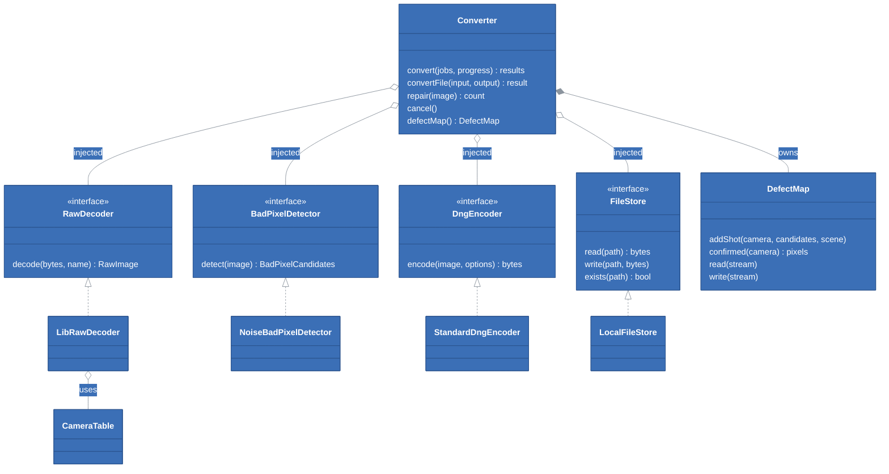
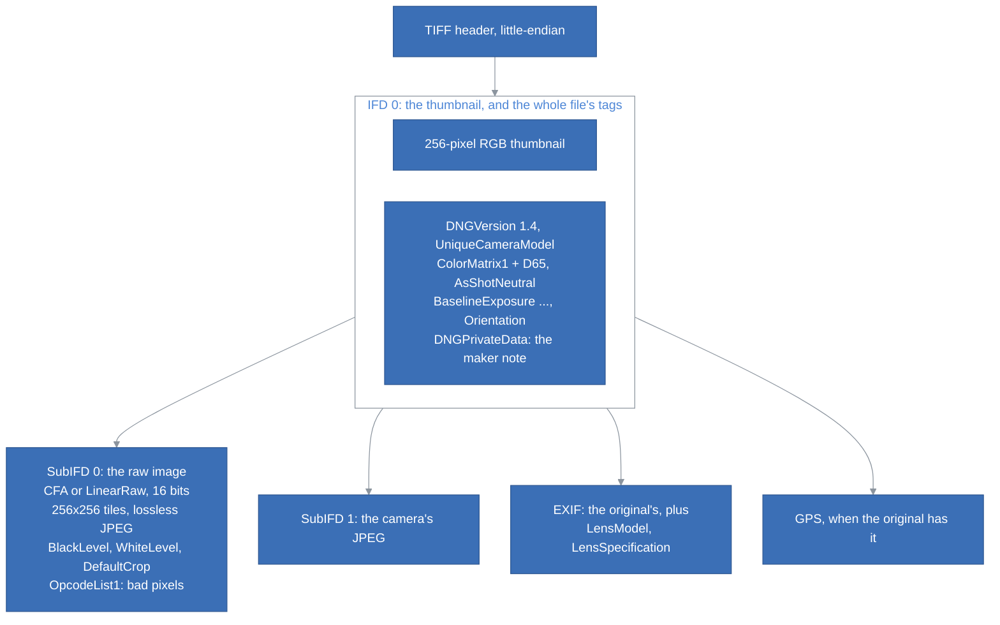

# dng-converter Architecture

## Table of Contents <!-- omit in toc -->

- [Introduction](#introduction)
- [The Big Picture](#the-big-picture)
- [The Modules](#the-modules)
- [The Classes](#the-classes)
  - [RawImage](#rawimage)
  - [RawDecoder and LibRawDecoder](#rawdecoder-and-librawdecoder)
  - [CameraTable](#cameratable)
  - [BadPixelDetector and DefectMap](#badpixeldetector-and-defectmap)
  - [DngEncoder](#dngencoder)
  - [FileStore](#filestore)
  - [Converter](#converter)
  - [The Command Line Tool](#the-command-line-tool)
- [SOLID, and Where It Stops](#solid-and-where-it-stops)
- [Dependency Injection and Tests](#dependency-injection-and-tests)
- [The DNG File](#the-dng-file)
- [Lossless JPEG](#lossless-jpeg)
- [Bad Pixels](#bad-pixels)
- [Threads](#threads)
- [Compared with Adobe DNG Converter](#compared-with-adobe-dng-converter)
- [The Container](#the-container)
- [Tests](#tests)
- [How to Extend the Converter](#how-to-extend-the-converter)
- [Design Decisions and Trade-offs](#design-decisions-and-trade-offs)
- [Known Limitations](#known-limitations)

## Introduction

This document explains how dng-converter is built, what each part is responsible for, and where to start when we want to change something. It assumes we have read the [README](../README.md) and converted a file once.

It follows one idea: **a DNG is the camera's raw data, untouched, plus what a raw converter needs to know to render it**. Everything the converter does serves one of those two halves:
- carry the sensor values across bit for bit;
- describe them exactly as Adobe DNG Converter would, so that Lightroom renders them the same way.

Fixing bad pixels is the one exception. Even then, by default, it only adds an instruction to the file, and the values stay as they are.

## The Big Picture

A conversion is a pipeline of five steps around one data model, `RawImage`. Each step is behind an interface, so any of them can be replaced: by a fake in the tests, or by an application that keeps its files somewhere else.

```mermaid
---
config:
  theme: base
  themeCSS: ".edgeLabel p { padding: 4px 10px; }"
  flowchart:
    padding: 20
    nodeSpacing: 40
    rankSpacing: 50
  class:
    padding: 16
  sequence:
    boxMargin: 12
    boxTextMargin: 8
    noteMargin: 28
    messageMargin: 40
    actorMargin: 60
    labelBoxWidth: 56
    labelBoxHeight: 28
  themeVariables:
    primaryColor: "#3b6fb6"
    primaryTextColor: "#ffffff"
    primaryBorderColor: "#2c5590"
    lineColor: "#8b949e"
    textColor: "#4d86d6"
    actorBkg: "#3b6fb6"
    actorBorder: "#2c5590"
    actorTextColor: "#ffffff"
    actorLineColor: "#8b949e"
    signalColor: "#8b949e"
    signalTextColor: "#4d86d6"
    noteBkgColor: "#3b6fb6"
    noteTextColor: "#ffffff"
    noteBorderColor: "#2c5590"
    secondaryColor: "#3b6fb6"
    tertiaryColor: "#3b6fb6"
    clusterBkg: "transparent"
    clusterBorder: "#8b949e"
    titleColor: "#4d86d6"
    edgeLabelBackground: "#3b6fb6"
    classText: "#ffffff"
    labelBoxBkgColor: "#3b6fb6"
    labelBoxBorderColor: "#2c5590"
    labelTextColor: "#ffffff"
    loopTextColor: "#4d86d6"
    mainBkg: "#3b6fb6"
    nodeBorder: "#2c5590"
    nodeTextColor: "#ffffff"
    secondaryBorderColor: "#2c5590"
    secondaryTextColor: "#ffffff"
    tertiaryBorderColor: "#2c5590"
    tertiaryTextColor: "#ffffff"
    errorBkgColor: "#3b6fb6"
    errorTextColor: "#ffffff"
---
flowchart LR
    In["CR2 file<br/>or bytes in memory"] --> Read["FileStore<br/>read"]
    Read --> Decode["RawDecoder<br/>LibRaw + TIFF reader<br/>+ CameraTable"]
    Decode --> Image["RawImage"]
    Image --> Detect["BadPixelDetector"]
    Detect --> Map["DefectMap<br/>per camera body"]
    Map --> Repair["repair<br/>opcode or interpolate"]
    Repair --> Encode["DngEncoder<br/>TIFF writer + lossless JPEG<br/>+ thumbnail"]
    Encode --> Write["FileStore<br/>write, atomically"]
    Write --> Out["DNG file"]

    classDef default fill:#3b6fb6,stroke:#2c5590,color:#ffffff
```



`Converter` runs the pipeline, one file per thread. In `BATCH` mode it first decodes every file, to learn each camera's defects, then converts them all: see [Bad Pixels](#bad-pixels). The command line tool, `dng-convert`, only parses its arguments, lists the files and prints the results. Everything else is in the library, `libdngconv`, which a bigger application links in the same way.

## The Modules

| Path | Role | Depends on |
|---|---|---|
| `include/dngconv/raw_image.hpp` | The data model: `RawImage`, `Metadata`, `PixelPos`, `Rect`. Plain structs, no behaviour beyond accessors. | `camera_table.hpp` |
| `include/dngconv/raw_reader.hpp`, `src/raw_reader.cpp` | `RawDecoder`, and `LibRawDecoder`, its LibRaw implementation. The only code that includes LibRaw. | LibRaw, `tiff_reader`, `camera_table` |
| `src/tiff/tiff_reader.*` | Reads TIFF directories in place, to copy the original EXIF, GPS and maker note into the DNG. | — |
| `include/dngconv/camera_table.hpp`, `src/camera_table.cpp` | Per-model values not in the raw file, e.g. the baseline exposure. | — |
| `include/dngconv/bad_pixels.hpp`, `src/bad_pixels.cpp` | `detectBadPixels`, `repairBadPixels`, the `BadPixelDetector` interface, `DefectMap`, `sceneSignature`. | `raw_image` |
| `include/dngconv/dng_writer.hpp`, `src/dng_writer.cpp` | `encodeDng`: which DNG tags, in which directory, with which values. The `DngEncoder` interface. | `tiff_writer`, `lj92_encoder`, `thumbnail` |
| `src/tiff/tiff_writer.*` | A generic TIFF writer: directories, child directories, data blocks, offsets. Knows nothing of DNG. | — |
| `src/lj92_encoder.*` | Lossless JPEG (ITU T.81 process 14). Knows nothing of TIFF or DNG. | — |
| `src/thumbnail.*` | The 256-pixel sRGB rendering in the DNG's first directory. | `raw_image` |
| `include/dngconv/file_store.hpp`, `src/file_store.cpp` | The `FileStore` interface, and `LocalFileStore`, with its atomic writes. | — |
| `include/dngconv/converter.hpp`, `src/converter.cpp` | `Converter`, which runs the pipeline over many files, and `planJobs`. | everything above, through interfaces |
| `src/parallel.hpp` | `parallelFor`: a loop over threads that rethrows the first exception. | — |
| `apps/dng-convert/` | The command line tool. `cli_options` (parsing, tested) and `main` (printing, signals). | the library |

The public headers are under `include/dngconv`, and `dngconv.hpp` includes them all. Nothing in them includes LibRaw, so an application that links the library doesn't need LibRaw's headers. Everything under `src` is private.

## The Classes



### RawImage

[`raw_image.hpp`](../include/dngconv/raw_image.hpp) holds everything the DNG needs, in DNG's own terms:
- the samples, row-major, black level included, exactly as the sensor recorded them;
- the 2x2 CFA pattern, the black level of each of its cells, the white level;
- the default crop, the orientation;
- the D65 colour matrix and the as-shot neutral;
- the camera traits;
- the metadata;
- the camera's JPEG preview.

It is a plain struct, so any step can build one or check one, and a test can make one in a few lines (see `tests/test_support.hpp`).

There are two layouts:
- `CFA`: one sample per pixel behind a Bayer filter, for a normal raw file;
- `LINEAR_RAW`: three samples per pixel, for Canon's sRAW and mRAW, which the camera has already demosaiced.

The DNG calls these `PhotometricInterpretation` 32803 and 34892.

### RawDecoder and LibRawDecoder

`RawDecoder::decode` turns the bytes of a raw file into a `RawImage`. [`LibRawDecoder`](../src/raw_reader.cpp) is the only class that knows LibRaw.

**The image is LibRaw's visible area**, i.e. the sensor without its masked border. For the 5D Mark III, that is exactly the `ActiveArea` Adobe declares, see [Compared with Adobe DNG Converter](#compared-with-adobe-dng-converter).

**The black level** of each CFA cell is LibRaw's, which it measures on the masked border: `black + cblack[slot]`, where `slot` is the colour index LibRaw gives that cell. The tests check it against the mean of the masked pixels.

**The white level** is the lower of LibRaw's `maximum` and Canon's own clipping level for the shot's ISO (`linear_max`, from the maker notes). A white level above the real clipping point turns blown highlights magenta; one below it clips them a little early, which is the safer side.

**The colour matrix** is LibRaw's `cam_xyz`: Adobe's D65 `ColorMatrix` for the camera, identical to the one Adobe DNG Converter writes. **The as-shot neutral** is the inverse of the camera's white balance multipliers.

**The default crop** is the crop the camera applies to its own JPEG, from Canon's maker notes (`DefaultCropAbsolute`), or else LibRaw's inset crop: 5616x3744 for the 5D Mark II, 4272x2848 for the 450D.

**The unique camera model** is LibRaw's normalised name, e.g. `Canon EOS 450D` for the Digital Rebel XSi and the Kiss X2. This matters: Lightroom finds its camera profiles, "Adobe Standard" and the Camera Matching ones, by this name.

**The metadata** comes from LibRaw and from the original file itself. For a TIFF-based raw file, e.g. CR2, [`tiff_reader`](../src/tiff/tiff_reader.cpp) copies:
- the EXIF and GPS directories;
- the Make, Model, Artist and Copyright tags;
- the maker note.

The values are byte-swapped to little-endian where needed. Pointers into the original file are not copied, and neither are tags that describe the original JPEG. Copying the original EXIF keeps everything Lightroom shows, e.g. exposure compensation and flash, without listing them one by one.

### CameraTable

Some of what Lightroom needs to render a photo as Adobe's DNG does is not in the raw file. Adobe DNG Converter takes it from its own table of cameras:

| Value | Effect in Lightroom |
|---|---|
| `BaselineExposure` | How bright an unedited photo opens: +0.25 EV for the 5D Mark III. |
| `BaselineNoise`, `BaselineSharpness` | How much default noise reduction and sharpening it applies. |
| `BayerGreenSplit` | How its demosaicing treats the two greens. |

[`CameraTable`](../include/dngconv/camera_table.hpp) holds these values per `UniqueCameraModel`. It contains only values read from Adobe's DNGs of real files, each with its source. A camera without a row gets the DNG defaults, which means its photos open darker than Adobe's DNG of the same file. A guessed value, wrong by a few tenths of a stop, would be no better.

`LibRawDecoder` takes the table in its constructor: `CameraTable::builtIn()` by default, or the application's own, e.g. one extended with the user's cameras.

### BadPixelDetector and DefectMap

`BadPixelDetector::detect` returns the image's bad pixels in two tiers, *confident* and *suspect*; `NoiseBadPixelDetector` calls `detectBadPixels`. `DefectMap` collects the candidates of many shots per camera body and says which suspects are confirmed. `repairBadPixels` replaces pixels with the median of their same-colour neighbours. How they work is in [Bad Pixels](#bad-pixels).

`DefectMap` reads and writes plain text from and to streams; it never opens a file itself. The command line tool opens the files, and an application can keep the map anywhere.

### DngEncoder

`DngEncoder::encode` turns a `RawImage` into the bytes of a DNG; `StandardDngEncoder` calls `encodeDng`. [`dng_writer.cpp`](../src/dng_writer.cpp) decides what goes into the file: which tags, in which directory, with which values (see [The DNG File](#the-dng-file)). The mechanics are left to three modules that know nothing of DNG:
- [`tiff_writer`](../src/tiff/tiff_writer.cpp) lays out directories, child directories and data blocks, and patches their offsets;
- [`lj92_encoder`](../src/lj92_encoder.cpp) compresses a tile;
- [`thumbnail`](../src/thumbnail.cpp) renders the preview the DNG's first directory must hold.

### FileStore

`FileStore` reads raw files and writes DNGs. [`LocalFileStore`](../src/file_store.cpp) writes each DNG under a temporary name next to the target, then renames it, so that:
- a reader, e.g. Lightroom watching a folder, never sees half a file;
- a crash never leaves a broken DNG in place of a good one.

The tests use an in-memory store. An application can use one that reads from a camera, or writes to a database.

### Converter

[`Converter`](../src/converter.cpp) runs the pipeline over a list of `ConvertJob`s, each a raw file and the path of its DNG:
- `convert` does it in parallel, and never throws for a single file: each file's outcome is in its `ConvertResult` (`CONVERTED`, `SKIPPED`, `FAILED` or `CANCELLED`);
- `convertFile` does one file;
- `repair` does the bad-pixel step alone, for an application that decodes and encodes by itself, e.g. from a buffer it downloaded from the camera.

It gets its four services in a `ConverterServices` struct. Any service left empty gets the production one. The defect map is its own: what it learns carries over from batch to batch.

`planJobs` turns an input file or folder into jobs, and mirrors sub-folders when recursive. Two raw files of the same name, `IMG_1.CR2` and `IMG_1.CR3`, get two DNG names, so neither silently overwrites the other.

### The Command Line Tool

[`cli_options.cpp`](../apps/dng-convert/cli_options.cpp) turns the arguments into `CliOptions`, or throws `std::invalid_argument` with a message for the user. It is a library of its own, so that the tests check it without running a process.

[`main.cpp`](../apps/dng-convert/main.cpp) does the rest:
- picks the bad pixel mode;
- loads and saves the defect map;
- prints progress;
- turns Ctrl-C into `Converter::cancel()`: the files being converted are finished, the others are cancelled.

## SOLID, and Where It Stops

**Single responsibility.** Each module answers one question:
- the TIFF writer: where do bytes go;
- the LJ92 encoder: how is a tile compressed;
- `dng_writer`: which tags describe this image;
- `raw_reader`: what does LibRaw say about this file;
- `bad_pixels`: which pixels are defects;
- `Converter`: in which order, on which thread, with which outcome.

The TIFF writer and the LJ92 encoder know nothing of DNG, so they can be checked against their own specifications.

**Open/closed.** A new raw decoder, detector, output format or storage is a new implementation of an interface, injected into `Converter`, which does not change. A new camera's rendering values are a row in the camera table, not a branch in the code.

**Liskov substitution.** Every implementation of an interface keeps its contract:
- `decode` throws `dngconv::Error` on a bad file and is safe to call from several threads at once;
- `FileStore::write` never exposes a partial file.

The fakes in the tests keep the same contract, which is why tests written against them say something about the real thing.

**Interface segregation.** The interfaces are as narrow as the converter's use of them: one method each, three for `FileStore`. `RawDecoder` does not expose LibRaw's options, `DngEncoder` does not expose tags.

**Dependency inversion.** `Converter` depends on the four interfaces, not on LibRaw, the file system or the encoder. The concrete classes are chosen in one place, `withDefaults()` in `converter.cpp`, or by the application.

**Where it stops.** The pure parts stay free functions: `detectBadPixels`, `repairBadPixels`, `encodeDng`, `encodeLosslessJpeg`, `sceneSignature`, `planJobs`. They have no side effects and nothing to replace, so a test calls them directly, and wrapping them in classes would only add a layer. They are wrapped in a class only where `Converter` needs a seam: `NoiseBadPixelDetector` and `StandardDngEncoder` are two lines each. `planJobs` reads the file system directly: listing a folder is what it is for, and its tests use a temporary folder.

## Dependency Injection and Tests

`ConverterServices` is the composition root:

```cpp
dngconv::ConverterServices services;
services.files = std::make_shared<MyCameraStore>();                 // replaced
services.decoder = std::make_shared<dngconv::LibRawDecoder>(my_table);  // configured
dngconv::Converter converter(options, services);                    // the rest: defaults
```

With all four services replaced by fakes (`tests/test_support.hpp`), the converter's tests check its logic, e.g. which pixels are repaired in `BATCH` mode, in a 32x32 image, with no LibRaw, no files and no encoding:
- `FakeDecoder` makes images whose camera and scene depend on the file;
- `FakeDetector` returns the candidates each test chooses;
- `CapturingEncoder` records what would be written;
- `MemoryFileStore` keeps the files in memory.

The real implementations are tested end to end instead, on real raw files, and checked by readers the code does not control:
- **LibRaw** reads every DNG back, and its samples are compared with the original raw file's, bit for bit.
- **ExifTool**'s validator checks the structure of every file.
- **Adobe DNG Converter**'s own DNG of a sample file is the reference for the values: the tests check that ours carries the same raw data and the same rendering values (see [Compared with Adobe DNG Converter](#compared-with-adobe-dng-converter)).

## The DNG File



The file follows the [DNG 1.4 specification](https://helpx.adobe.com/camera-raw/digital-negative.html), the version Adobe DNG Converter writes:
- `DNGBackwardVersion` is 1.1, or 1.3 when there is an opcode list.
- The raw image is in 256x256 tiles, as Adobe's is, and the tiles on the right and bottom edges are padded by repeating the last column and row, as TIFF requires.
- The maker note goes into `DNGPrivateData` in Adobe's `MakN` format: the original byte order and the maker note's original offset, which readers need to follow the offsets inside it. ExifTool decodes all 255 Canon maker note tags from it.
- `RawDataUniqueID` is a 128-bit hash of the samples, so the same photo converted twice has the same ID. Lightroom uses it to recognise copies.
- The camera's own JPEG preview is kept as the preview, with its sRGB colour space and its real chroma subsampling read from the JPEG itself.

## Lossless JPEG

DNG compresses raw data with lossless JPEG (compression 7): about half the size of 16-bit samples, and decoded by every DNG reader. [`lj92_encoder.cpp`](../src/lj92_encoder.cpp) implements it in about 300 lines:
- **Predictor 1**: each sample is predicted by the one to its left.
- **A Bayer tile is encoded as a frame half as wide, with two interleaved components**, as Adobe does: the left neighbour of each sample in its component is then two pixels to its left, which has the same colour. That is what makes the prediction good.
- **The Huffman table is built for each tile** from its own differences, by the procedure of T.81 Annex K.2, limited to 16 bits (K.3), with the code of all ones reserved.
- A difference of -32768 is category 16 with no extra bits, as DNG readers expect. Bytes of `0xff` are stuffed with `0x00`, and the last byte is padded with ones.

The tests encode random 16-bit samples, the worst case, at sizes that cut tiles on both edges, and LibRaw decodes them back bit for bit. Real files lose nothing either: every sample file round-trips exactly.

## Bad Pixels

A hot pixel is brighter than the light falling on it; a dead one stays dark; a stuck one is always at the white level. All three are a single pixel that does not match its surroundings. A detail of the scene, however small, does: the lens and the anti-aliasing filter of these cameras spread every point of light over several pixels.

**Detection** ([`bad_pixels.cpp`](../src/bad_pixels.cpp)) compares each pixel with its eight nearest pixels of the same colour:
- **The noise model** is measured on the image itself: the noise as a function of the signal, by the median absolute difference of same-colour pixel pairs, in brightness bins. That way, "far above its neighbours" is measured in units of this image's noise at this brightness. ISO 100 and ISO 6400 need no settings of their own.
- **A hot pixel** must be above *all* its same-colour neighbours, by a number of noise units and by a ratio. A dead one must be below all of them. Most pixels are rejected after two or three comparisons.
- **The neighbour test** rejects detail. Each of the 8 adjacent pixels, of any colour, is compared with *its own* same-colour surroundings. If they stand out too, in the same direction, the spot is detail. A defect stands out alone.
- **The cross-colour test** rejects the edge of a bright area: a suspect pixel next to a pixel of another colour that is about as bright, once white-balanced.

Pixels within four pixels of the image's edge are not examined: their neighbours' neighbours would be outside it. On these cameras they are outside the default crop, or on its outermost row.

**Two tiers.** A *confident* pixel, 25 noise units and 3 times above its neighbours, is repaired in any case. A *suspect* one, 8 units and 1.6 times, could also be a faint warm pixel or fine detail. One shot cannot tell which, so a suspect is only repaired when the defect map confirms it.

**The defect map.** A sensor defect is in the same place whatever the scene; detail is only where the scene puts it. `DefectMap` therefore counts, for each camera body (model, serial number and image size), the *scenes* in which each suspect appeared.

A scene is recognised by its `sceneSignature`: an 8x8 grid of brightness in stops, relative to its mean, so it doesn't depend on exposure. Shots whose signatures differ by less than a third of a stop on average are the same scene. That way, a bracket, a time-lapse or a stack of star photos from a tripod counts as *one* scene, and a bright detail fixed in it can't confirm itself.

A suspect seen in at least 2 different scenes, and in at least a quarter of the camera's scenes, is confirmed. It is then repaired in *every* shot of that camera, including those where the scene hides it. The confirmed defects can be saved and loaded (`--defect-map`), so that what one batch learns serves the next.

**Repair.** With `OPCODE`, the default, the samples stay as they are, and the DNG gets a `FixBadPixelsList` opcode in `OpcodeList1`. Lightroom and Camera Raw apply it when rendering, and the original values remain in the file. The opcode is marked optional, so a reader that cannot apply opcodes still opens the file. With `INTERPOLATE`, the samples are replaced by the median of their same-colour neighbours, for raw converters that ignore opcodes.

**What it finds on the samples.** The 5D Mark II file at ISO 800 has 22 confident hot pixels and 18 suspects. The one with a 1.6 s exposure at ISO 100 has 8 confident and 644 suspects. The confident ones are single spikes, e.g. a green at 456 among greens near 50. The suspects of the long exposure are faint warm pixels and the edges of fine detail, which one shot cannot tell apart: that is what the scene confirmation decides. Before the cross-colour test, that file had 2810 suspects. The 5D Mark III sample, the 450D's, and three 5D Mark II shots of a bright scene have none or one or two.

## Threads

`Converter` converts one file per thread, up to one thread per core and at most 8 by default. Each file in flight takes about 150 MB: the file, LibRaw's buffers, the image and the encoded DNG. When there are fewer files than threads, the threads left over compress the tiles of each file.

[`parallelFor`](../src/parallel.hpp) is the only place that starts threads:
- An exception thrown on a thread is caught, the other threads finish, and the first exception is rethrown to the caller. An exception that escaped a thread would end the whole program, i.e. the application that links the library.
- `Converter` catches every file's exception itself, so one bad file never stops a batch.
- The progress callback runs under a lock, so the application sees one call at a time, and an exception from it is ignored.
- `cancel()` is safe to call from any thread, and from a signal handler: it only stores to a lock-free atomic.

`LibRaw` is not thread safe per instance, so each file gets its own. The library links `libraw_r`, LibRaw's thread-safe flavour.

## Compared with Adobe DNG Converter

raw.pixls.us has a 5D Mark III raw file, `5G4A9394.CR2`, and the DNG that Adobe DNG Converter 9.8 made of it, both in the public domain. `bin/fetch-samples.sh` downloads them, and `test_adobe_reference` compares our DNG with Adobe's:

| | Adobe DNG Converter 9.8 | dng-converter |
|---|---|---|
| Raw samples | — | **identical**, all 22 430 520 of the active area |
| Image stored | the whole sensor, 5920x3950, with `ActiveArea` | the active area, 5796x3870 |
| DefaultCrop, CFA pattern, orientation | — | identical |
| UniqueCameraModel | `Canon EOS 5D Mark III` | identical |
| D65 colour matrix | `ColorMatrix2` | identical, as `ColorMatrix1` |
| Standard light A matrix, forward matrices, camera calibration | yes | no: see below |
| AsShotNeutral | — | identical |
| BaselineExposure, BaselineNoise, BaselineSharpness, BayerGreenSplit | 0.25, 0.8, 1.2, 100 | identical, from the camera table |
| Black level | 2047 or 2048 per cell | 2047 or 2048 per cell; the 2048 is on the cell the masked pixels say |
| White level | 15000 | 15321, Canon's clipping level at ISO 200 |
| Embedded profile | Adobe Standard, with its HueSat and look tables | none |
| Previews | Adobe's renderings, 1024 pixels and full size | the camera's JPEG, full size |
| Bad pixels | not changed | not changed (default `OPCODE`) |

**What the differences mean.**
- **White level**: ours makes a photo 0.035 EV darker than Adobe's (12 953 levels above black against 13 274), and keeps the brightest 2% of Adobe's range as highlight detail rather than clipped white.
- **Embedded profile**: Lightroom applies its own Adobe Standard profile, found by `UniqueCameraModel`, so it is not needed in the file. It is also Adobe's copyrighted data, which we must not copy.
- **Matrices**: the extra matrices only matter to a raw converter that has no profile of its own for the camera.
- **Previews**: Lightroom renders its own previews on import.

Rendered by LibRaw, with each DNG's own tags, the two files have the same colour balance, to 0.5%.

## The Container

The container is defined in [`docker/docker-compose.yml`](../docker/docker-compose.yml) and driven by [`dock.sh`](../docker/dock.sh), as in the StepIt modules, with the scripts in `bin` on its `PATH`. What is specific to the converter:
- The image is plain Ubuntu 24.04, with CMake, Ninja, `libraw-dev`, GoogleTest, ExifTool and clang-format: nothing to install on the host.
- When the rig's package cache (`stepit-apt-cache`, on port 3142) is running, the image downloads its packages through it.
- `DNG_USER_SAMPLES`, in `docker/.env`, mounts a folder of our own raw files read only at `~/user-samples`. The tests then convert them too.

## Tests

| Test | What it covers |
|---|---|
| `test_dng_writer` | Random 16-bit samples, CFA and linear, compressed and not, at sizes that cut tiles, read back bit for bit by LibRaw. The tags Lightroom needs, their types and values. The opcode list, byte by byte. EXIF copy and lens fields. Rejecting inconsistent images. Atomic replacement. |
| `test_bad_pixels` | No false defects in clean noise. Hot, stuck and dead pixels found. Faint warm pixels are suspects. Stars and highlights left alone. Repair from same-colour neighbours only. Confirmation by different scenes, not by a repeated one. Scene signatures don't depend on exposure. The defect map's text format, CRLF included. |
| `test_converter` | With fakes: per-image and batch repair, opcode against interpolation, `OFF`, skipping existing files, one bad file not stopping a batch, cancellation, a progress callback that throws, 40 files on 8 threads in order, defects outside the image. `planJobs`: extensions, recursion, duplicate names. |
| `test_cli_options` | Every option, the help, the errors, the automatic bad-pixel mode. |
| `test_samples` | Every raw file of `samples` and `~/user-samples`: converted, read back by LibRaw, compared with the original's samples (only the repaired pixels may differ), black level, CFA, white balance, and the unique camera model. |
| `test_adobe_reference` | Our DNG of the 5D Mark III sample against Adobe's: raw data, crop, matrix, white balance, camera traits. |
| `dng_convert_exiftool_validate` | The command line tool on all samples, every DNG checked by `exiftool -validate`. |

LibRaw's DNG reader misplaces the samples of images narrower than one tile, or exactly two tiles (512 pixels) wide: [`dng.cpp:100` and `:111`](https://github.com/LibRaw/LibRaw/blob/0.21.2/src/decoders/dng.cpp#L96-L113) assume the tiles of a wider image. No camera makes such images, and the files are valid, so the round-trip tests use other sizes.

## How to Extend the Converter

**A new camera** needs no code if LibRaw supports it, and most do. For it to open exactly as bright as Adobe's DNG, add its row to the camera table in [`camera_table.cpp`](../src/camera_table.cpp), with the values from one of its raw files converted by Adobe DNG Converter (the command is in the file), and the source.

**A camera in an application's own table**: build a `CameraTable`, `set()` the rows, and give it to `LibRawDecoder`, in `ConverterServices`.

**Another storage**, e.g. files downloaded from a camera into memory, is another `FileStore`. To convert a single buffer, call `readRawBuffer`, `Converter::repair` and `encodeDng` directly.

**Another raw decoder**, e.g. for a format LibRaw lacks, is another `RawDecoder`. It must fill in a `RawImage`, and the tests in `test_samples` then apply to it as they are.

**Another output**, e.g. a TIFF rendering, is another `DngEncoder`.

**A better detector** is another `BadPixelDetector`. `DefectMap` and the repair don't change, as long as it reports confident and suspect pixels.

## Design Decisions and Trade-offs

**LibRaw to decode, our own code to write.** LibRaw is the most complete open decoder of raw files, and it is LGPL or CDDL, which an MIT project can link. For writing, the reference is Adobe's DNG SDK, but its licence is Adobe's own, not an open-source one: this project uses none of it. Other open converters are in other languages (dnglab, in Rust) or unmaintained and GPL (raw2dng). A DNG writer is a TIFF writer, a lossless JPEG encoder and a list of tags: about 2000 lines, all of them tested against independent readers.

**The active area, not the whole sensor.** Adobe also stores the masked border, which only a raw converter that measures its own black level uses. Storing the active area is simpler and smaller, and gives the same image: the tests prove the samples identical.

**One colour matrix.** Adobe writes a second matrix, for standard light A, and forward matrices, from its own camera profiles, which are its copyrighted data. LibRaw only has the D65 matrix, which is the one Lightroom uses when it has no profile of its own for the camera. For a camera Lightroom knows, it uses its own profile, so only the colour of an unknown camera's photos under tungsten light can differ.

**The camera's JPEG as the preview.** Rendering a preview as good as Adobe's would mean a full raw converter. The camera's JPEG is better than anything simpler, costs nothing, and is what the camera showed. Lightroom renders its own previews anyway.

**Opcode by default.** Adobe DNG Converter never changes the raw data. A detector can mistake a single-pixel light source of one saturated colour, e.g. a distant red LED, for a hot pixel, and an opcode keeps the original value in the file. `INTERPOLATE` is there for raw converters that ignore opcodes.

**Defects confirmed by different scenes.** Counting the shots of a camera would let a tripod sequence confirm its own detail. Counting scenes doesn't, at the cost of needing photos of more than one scene before a faint defect is repaired.

**Verified values only, in the camera table.** A row without a source would make the converter look right while being wrong by a few tenths of a stop. Leaving a camera out is visible, and fixable with one Adobe DNG.

**The canonical white level.** Canon records its clipping level for each ISO, LibRaw reads it, and the raw data reaches it: up to 15 464 in the 5D Mark III sample. Adobe's fixed 15000 makes it clip slightly earlier. Matching Adobe's would take a per-camera, per-ISO table we can't verify.

## Known Limitations

- **Unknown cameras open darker** than Adobe's DNG, by their baseline exposure, typically 0.25 to 0.5 EV for Canon, until their row is added to the camera table. **The 5D Mark II and the 450D have no row yet**: we have no Adobe DNG of either.
- **No `NewRawImageDigest`.** Lightroom's "Validate DNG Files" reports these files as having no digest to validate, rather than as damaged.
- **No embedded original raw file** (Adobe's "Embed Original Raw File" option).
- **Fujifilm X-Trans and other non-Bayer sensors** are refused with an error.
- **POSIX only, for now**: `getpid` and `localtime_r`. Windows needs their equivalents.
