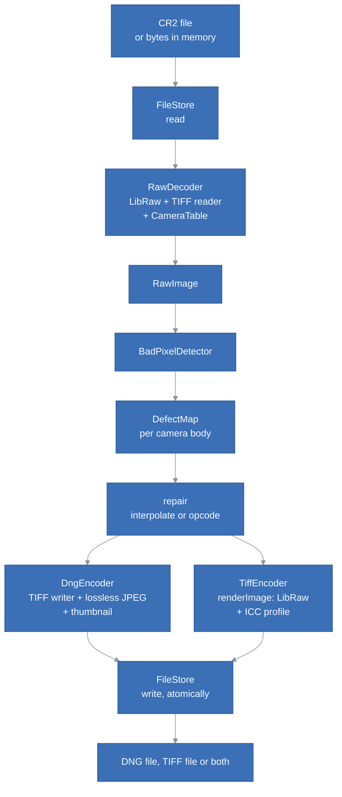
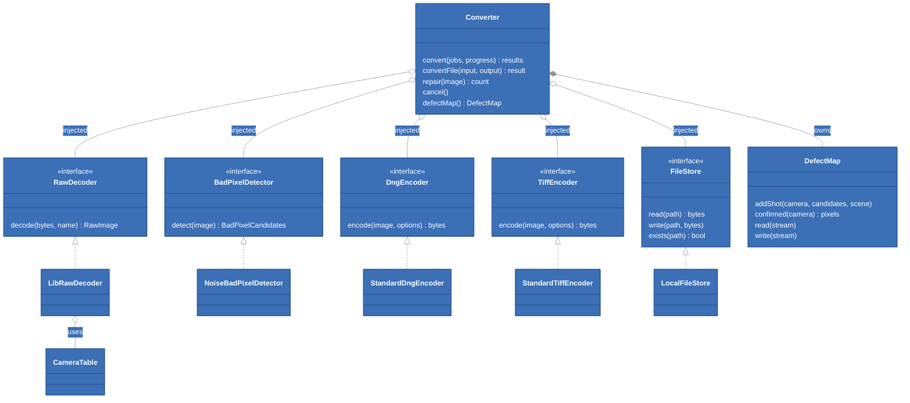
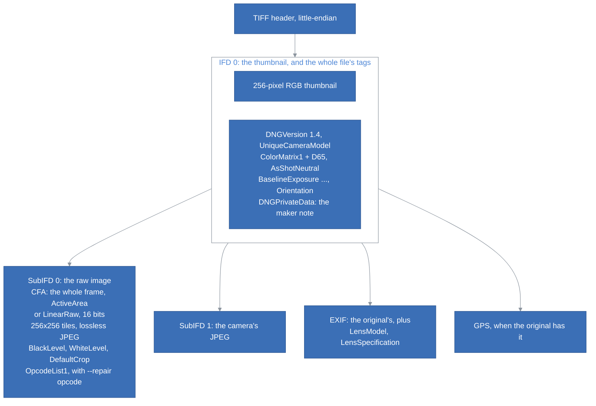

# raw-converter Architecture

## Table of Contents <!-- omit in toc -->

- [Introduction](#introduction)
- [The Big Picture](#the-big-picture)
- [The Modules](#the-modules)
- [The Classes](#the-classes)
  - [RawImage](#rawimage)
  - [RawDecoder and LibRawDecoder](#rawdecoder-and-librawdecoder)
  - [CameraTable](#cameratable)
  - [BadPixelDetector and DefectMap](#badpixeldetector-and-defectmap)
  - [DngEncoder](#dngencoder)
  - [TiffEncoder and renderImage](#tiffencoder-and-renderimage)
  - [FileStore](#filestore)
  - [Converter](#converter)
  - [The Command Line Tool](#the-command-line-tool)
- [SOLID, and Where It Stops](#solid-and-where-it-stops)
- [Dependency Injection and Tests](#dependency-injection-and-tests)
- [The DNG File](#the-dng-file)
- [Lossless JPEG](#lossless-jpeg)
- [The TIFF File](#the-tiff-file)
- [Bad Pixels](#bad-pixels)
- [Threads](#threads)
- [Compared with Adobe DNG Converter](#compared-with-adobe-dng-converter)
  - [The 5D Mark III](#the-5d-mark-iii)
  - [The 5D Mark II](#the-5d-mark-ii)
- [The Container](#the-container)
- [Tests](#tests)
- [How to Extend the Converter](#how-to-extend-the-converter)
- [Design Decisions and Trade-offs](#design-decisions-and-trade-offs)
- [Known Limitations](#known-limitations)

## Introduction

This document explains how raw-converter is built, what each part is responsible for, and where to start when we want to change something. It assumes we have read the [README](../README.md) and converted a file once.

The converter reads a raw file into one model, `RawImage`, repairs its bad pixels if asked, and writes it as one of two files, or both:

- **The DNG is the camera's raw data, plus what a raw editor needs to know to render it.** Everything its writer does serves one of those two halves: carry the sensor values across bit for bit, and describe them exactly as Adobe DNG Converter would, so that any raw editor renders them as it renders Adobe's DNG (see [The DNG File](#the-dng-file)).
- **The TIFF is the image, rendered and nothing more**, for programs that take pixels rather than raw data, e.g. StepIt Stacker's focus stacking. LibRaw demosaics it, white balances it as shot and converts it to a colour space whose ICC profile the file carries. It adds nothing that such a program would have to undo: no exposure, no tone curve, no sharpening (see [The TIFF File](#the-tiff-file)).

Both come from the same `RawImage`, so they show the same pixels, repaired the same way. Repairing bad pixels is off by default, because Adobe DNG Converter does not do it: by default, our DNG holds the same samples as Adobe's, bit for bit, masked border included. When asked, the repaired values replace the bad ones in the active area, and every other sample stays as it is.

## The Big Picture

A conversion is a pipeline of five steps around one data model, `RawImage`. Each step is behind an interface, so any of them can be replaced: by a fake in the tests, or by an application that keeps its files somewhere else.



`Converter` runs the pipeline, one file per thread, and encodes each image as the format asks: DNG, TIFF or both. In `BATCH` mode it first decodes every file, to learn each camera's defects, then converts them all: see [Bad Pixels](#bad-pixels). The command line tool, `raw-convert`, only parses its arguments, lists the files and prints the results. Everything else is in the library, `librawconv`, which a bigger application links in the same way.

## The Modules

| Path | Role | Depends on |
|---|---|---|
| `include/rawconv/raw_image.hpp` | The data model: `RawImage`, `Metadata`, `PixelPos`, `Rect`. Plain structs, no behaviour beyond accessors. | `camera_table.hpp` |
| `include/rawconv/raw_reader.hpp`, `src/raw_reader.cpp` | `RawDecoder`, and `LibRawDecoder`, its LibRaw implementation. With `renderer`, the only code that includes LibRaw. | LibRaw, `tiff_reader`, `camera_table` |
| `include/rawconv/renderer.hpp`, `src/renderer.cpp` | `renderImage`: a `RawImage` demosaiced by LibRaw into a `RenderedImage`, linear RGB. `ColorSpace`. | LibRaw, `dng_writer`, `bad_pixels` |
| `include/rawconv/tiff_output.hpp`, `src/tiff_output.cpp` | `encodeTiff`: a `RenderedImage` as a 16-bit RGB TIFF. `iccProfile`, made with Little CMS. The `TiffEncoder` interface. | Little CMS, `renderer`, `tiff_writer`, `exif` |
| `src/exif.*` | The EXIF and GPS directories of a written file, from the original's: shared by the DNG and the TIFF. | `tiff_writer` |
| `src/tiff/tiff_reader.*` | Reads TIFF directories in place, to copy the original EXIF, GPS and maker note into the DNG. | — |
| `include/rawconv/camera_table.hpp`, `src/camera_table.cpp` | Per-model values not in the raw file, e.g. the baseline exposure. | — |
| `include/rawconv/bad_pixels.hpp`, `src/bad_pixels.cpp` | `detectBadPixels`, `repairBadPixels`, the `BadPixelDetector` interface, `DefectMap`, `sceneSignature`. | `raw_image` |
| `include/rawconv/dng_writer.hpp`, `src/dng_writer.cpp` | `encodeDng`: which DNG tags, in which directory, with which values. The `DngEncoder` interface. | `tiff_writer`, `lj92_encoder`, `thumbnail` |
| `src/tiff/tiff_writer.*` | A generic TIFF writer: directories, child directories, data blocks, offsets. Knows nothing of DNG. Writes the DNG and the TIFF alike. | — |
| `src/lj92_encoder.*` | Lossless JPEG (ITU T.81 process 14). Knows nothing of TIFF or DNG. | — |
| `src/thumbnail.*` | The 256-pixel sRGB rendering in the DNG's first directory. | `raw_image` |
| `include/rawconv/file_store.hpp`, `src/file_store.cpp` | The `FileStore` interface, and `LocalFileStore`, with its atomic writes. | — |
| `include/rawconv/converter.hpp`, `src/converter.cpp` | `Converter`, which runs the pipeline over many files, and `planJobs`. | everything above, through interfaces |
| `src/parallel.hpp` | `parallelFor`: a loop over threads that rethrows the first exception. | — |
| `apps/raw-convert/` | The command line tool. `cli_options` (parsing, tested) and `main` (printing, signals). | the library |

The public headers are under `include/rawconv`, and `rawconv.hpp` includes them all. Nothing in them includes LibRaw or Little CMS, so an application that links the library doesn't need their headers. Everything under `src` is private.

## The Classes



### RawImage

[`raw_image.hpp`](../include/rawconv/raw_image.hpp) holds everything the DNG needs, in DNG's own terms:
- the samples of the active area, row-major, black level included, exactly as the sensor recorded them;
- the whole frame of the sensor, masked border included, and where the active area lies in it;
- the 2x2 CFA pattern, the black level of each of its cells, the white level;
- the default crop, the orientation;
- the D65 colour matrix and the as-shot neutral;
- the camera traits;
- the metadata;
- the camera's JPEG preview.

It is a plain struct, so any step can build one or check one, and a test can make one in a few lines (see `tests/test_support.hpp`).

There are two layouts:
- `CFA`: one sample per pixel behind a Bayer filter, for a normal raw file;
- `LINEAR_RAW`: three samples per pixel, for Canon's sRAW and mRAW, which the camera has already demosaiced.

The DNG calls these `PhotometricInterpretation` 32803 and 34892.

### RawDecoder and LibRawDecoder

`RawDecoder::decode` turns the bytes of a raw file into a `RawImage`. [`LibRawDecoder`](../src/raw_reader.cpp) is the only class that knows LibRaw.

**The image is the active area** of the sensor, and the whole frame, masked border included, is kept beside it, for the DNG to store as Adobe's does. Every step but the encoder works on the active area alone: the bad pixels, the thumbnail, the scene signature. The encoder writes the frame, with the active area's samples, repaired or not, in their place.

**The active area** is Adobe's, from the camera table, when the camera has a row; else LibRaw's visible area. The two are the same for the 5D Mark III. For the 5D Mark II, Adobe's starts one row higher, at row 51 of the frame, and the CFA pattern and the default crop, which count from the active area's corner, shift with it. A camera without a row may therefore have an active area a row or a column off Adobe's, around the same crop.

**The black level** of each CFA cell is LibRaw's, which it measures on the masked border: `black + cblack[slot]`, where `slot` is the colour index LibRaw gives that cell. The tests check it against the mean of the masked pixels.

**The white level** is the lower of LibRaw's `maximum` and Canon's own clipping level for the shot's ISO (`linear_max`, from the maker notes). A white level above the real clipping point turns blown highlights magenta; one below it clips them a little early, which is the safer side.

**The colour matrix** is LibRaw's `cam_xyz`: Adobe's D65 `ColorMatrix` for the camera, identical to the one Adobe DNG Converter writes. **The as-shot neutral** is the inverse of the camera's white balance multipliers.

**The default crop** is the crop the camera applies to its own JPEG, from Canon's maker notes (`DefaultCropAbsolute`), or else LibRaw's inset crop: 5616x3744 for the 5D Mark II, 4272x2848 for the 450D.

**The orientation** is the original file's own `Orientation` tag, as Adobe DNG Converter does, and LibRaw's only when the file has none. The two can differ: the camera writes the tag according to its auto-rotate setting, while LibRaw takes Canon's maker note, which records how the camera was physically held. In Giovanni's 5D Mark II files, the tag is 1, upright, and the maker note, so LibRaw, says rotated by 270 degrees: a DNG with LibRaw's orientation opens on its side.

**The unique camera model** is LibRaw's normalised name, e.g. `Canon EOS 450D` for the Digital Rebel XSi and the Kiss X2. This matters: raw editors find their profiles for a camera by this name.

**The metadata** comes from LibRaw and from the original file itself. For a TIFF-based raw file, e.g. CR2, [`tiff_reader`](../src/tiff/tiff_reader.cpp) copies:
- the EXIF and GPS directories;
- the Make, Model, Artist and Copyright tags;
- the maker note.

The values are byte-swapped to little-endian where needed. Pointers into the original file are not copied, and neither are tags that describe the original JPEG. Copying the original EXIF keeps everything a photo manager shows, e.g. exposure compensation and flash, without listing them one by one.

### CameraTable

Some of what a raw editor needs to render a photo as it renders Adobe's DNG is not in the raw file. Adobe DNG Converter takes it from its own table of cameras:

| Value | Effect when rendering |
|---|---|
| `BaselineExposure` | How bright an unedited photo opens: +0.4 EV for the 5D Mark II, +0.25 EV for the 5D Mark III. |
| `BaselineNoise`, `BaselineSharpness` | How much default noise reduction and sharpening it applies. |
| `BayerGreenSplit` | How its demosaicing treats the two greens. |
| `ActiveArea` | Which pixels of the frame hold the image, from which the CFA pattern and the default crop count. |

[`CameraTable`](../include/rawconv/camera_table.hpp) holds these values per `UniqueCameraModel`. It contains only values read from Adobe's DNGs of real files, each with its source. A camera without a row gets the DNG defaults and LibRaw's active area, which means its photos open darker than Adobe's DNG of the same file. A guessed value, wrong by a few tenths of a stop, would be no better.

`LibRawDecoder` takes the table in its constructor: `CameraTable::builtIn()` by default, or the application's own, e.g. one extended with the user's cameras.

### BadPixelDetector and DefectMap

`BadPixelDetector::detect` returns the image's bad pixels in two tiers, *confident* and *suspect*; `NoiseBadPixelDetector` calls `detectBadPixels`. `DefectMap` collects the candidates of many shots per camera body and says which suspects are confirmed. `repairBadPixels` replaces pixels with the median of their same-colour neighbours. How they work is in [Bad Pixels](#bad-pixels).

`DefectMap` reads and writes plain text from and to streams; it never opens a file itself. The command line tool opens the files, and an application can keep the map anywhere.

### DngEncoder

`DngEncoder::encode` turns a `RawImage` into the bytes of a DNG; `StandardDngEncoder` calls `encodeDng`. [`dng_writer.cpp`](../src/dng_writer.cpp) decides what goes into the file: which tags, in which directory, with which values (see [The DNG File](#the-dng-file)). The mechanics are left to three modules that know nothing of DNG:
- [`tiff_writer`](../src/tiff/tiff_writer.cpp) lays out directories, child directories and data blocks, and patches their offsets;
- [`lj92_encoder`](../src/lj92_encoder.cpp) compresses a tile;
- [`thumbnail`](../src/thumbnail.cpp) renders the preview the DNG's first directory must hold.

### TiffEncoder and renderImage

`TiffEncoder::encode` turns a `RawImage` into the bytes of a TIFF; `StandardTiffEncoder` renders it with `renderImage`, then encodes it with `encodeTiff`. The two halves are apart:
- [`renderer.cpp`](../src/renderer.cpp) turns raw data into pixels, with LibRaw: a `RenderedImage`, linear RGB, 16 bits per sample, the default crop, with its colour space, orientation and metadata;
- [`tiff_output.cpp`](../src/tiff_output.cpp) turns pixels into a file: the tags, the strips, the ICC profile and the EXIF.

An application can render without writing, e.g. to stack the frames in memory. How the rendering works is in [The TIFF File](#the-tiff-file).

### FileStore

`FileStore` reads raw files and writes DNG and TIFF files. [`LocalFileStore`](../src/file_store.cpp) writes each DNG under a temporary name next to the target, then renames it, so that:
- a reader, e.g. a photo manager watching a folder, never sees half a file;
- a crash never leaves a broken file in place of a good one.

The tests use an in-memory store. An application can use one that reads from a camera, or writes to a database.

### Converter

[`Converter`](../src/converter.cpp) runs the pipeline over a list of `ConvertJob`s, each a raw file and the path of its DNG. The TIFF takes the same path with `.tif` (`outputPaths`). `ConvertOptions::format` says which to write: `DNG`, `TIFF` or `DNG_AND_TIFF`. Without `overwrite`, only the files that don't exist are written, and a job whose files all exist is skipped.
- `convert` does it in parallel, and never throws for a single file: each file's outcome is in its `ConvertResult` (`CONVERTED`, `SKIPPED`, `FAILED` or `CANCELLED`);
- `convertFile` does one file;
- `repair` does the bad-pixel step alone, for an application that decodes and encodes by itself, e.g. from a buffer it downloaded from the camera.

It gets its five services in a `ConverterServices` struct. Any service left empty gets the production one. The defect map is its own: what it learns carries over from batch to batch.

`planJobs` turns an input file or folder into jobs, and mirrors sub-folders when recursive. Two raw files of the same name, `IMG_1.CR2` and `IMG_1.CR3`, get two DNG names, so neither silently overwrites the other.

### The Command Line Tool

[`cli_options.cpp`](../apps/raw-convert/cli_options.cpp) turns the arguments into `CliOptions`, or throws `std::invalid_argument` with a message for the user. It is a library of its own, so that the tests check it without running a process.

[`main.cpp`](../apps/raw-convert/main.cpp) does the rest:
- picks the bad pixel mode;
- loads and saves the defect map;
- prints progress;
- turns Ctrl-C into `Converter::cancel()`: the files being converted are finished, the others are cancelled.

## SOLID, and Where It Stops

**Single responsibility.** Each module answers one question:
- the TIFF writer: where do bytes go;
- the LJ92 encoder: how is a tile compressed;
- `dng_writer`: which tags describe this image;
- `renderer`: what are its pixels, demosaiced;
- `tiff_output`: which tags and profile describe those pixels;
- `raw_reader`: what does LibRaw say about this file;
- `bad_pixels`: which pixels are defects;
- `Converter`: in which order, on which thread, with which outcome.

The TIFF writer and the LJ92 encoder know nothing of DNG, so they can be checked against their own specifications.

**Open/closed.** A new raw decoder, detector, output format or storage is a new implementation of an interface, injected into `Converter`, which does not change. A new camera's rendering values are a row in the camera table, not a branch in the code.

**Liskov substitution.** Every implementation of an interface keeps its contract:
- `decode` throws `rawconv::Error` on a bad file and is safe to call from several threads at once;
- `FileStore::write` never exposes a partial file.

The fakes in the tests keep the same contract, which is why tests written against them say something about the real thing.

**Interface segregation.** The interfaces are as narrow as the converter's use of them: one method each, three for `FileStore`. `RawDecoder` does not expose LibRaw's options, `DngEncoder` does not expose tags.

**Dependency inversion.** `Converter` depends on the five interfaces, not on LibRaw, the file system or the encoder. The concrete classes are chosen in one place, `withDefaults()` in `converter.cpp`, or by the application.

**Where it stops.** The pure parts stay free functions: `detectBadPixels`, `repairBadPixels`, `encodeDng`, `renderImage`, `encodeTiff`, `iccProfile`, `encodeLosslessJpeg`, `sceneSignature`, `planJobs`. They have no side effects and nothing to replace, so a test calls them directly, and wrapping them in classes would only add a layer. They are wrapped in a class only where `Converter` needs a seam: `NoiseBadPixelDetector`, `StandardDngEncoder` and `StandardTiffEncoder` are two lines each. `planJobs` reads the file system directly: listing a folder is what it is for, and its tests use a temporary folder.

## Dependency Injection and Tests

`ConverterServices` is the composition root:

```cpp
rawconv::ConverterServices services;
services.files = std::make_shared<MyCameraStore>();                 // replaced
services.decoder = std::make_shared<rawconv::LibRawDecoder>(my_table);  // configured
rawconv::Converter converter(options, services);                    // the rest: defaults
```

With all five services replaced by fakes (`tests/test_support.hpp`), the converter's tests check its logic, e.g. which pixels are repaired in `BATCH` mode, in a 32x32 image, with no LibRaw, no files and no encoding:
- `FakeDecoder` makes images whose camera and scene depend on the file;
- `FakeDetector` returns the candidates each test chooses;
- `CapturingEncoder` and `CapturingTiffEncoder` record what would be written;
- `MemoryFileStore` keeps the files in memory.

The real implementations are tested end to end instead, on real raw files, and checked by readers the code does not control:
- **LibRaw** reads every DNG back, and its samples are compared with the original raw file's, bit for bit.
- **ExifTool**'s validator checks the structure of every file.
- **Adobe DNG Converter**'s own DNG of a sample file is the reference for the values: the tests check that ours carries the same raw data and the same rendering values (see [Compared with Adobe DNG Converter](#compared-with-adobe-dng-converter)).

## The DNG File



The file follows the [DNG 1.4 specification](https://helpx.adobe.com/camera-raw/digital-negative.html), the version Adobe DNG Converter writes:
- `DNGBackwardVersion` is 1.1, or 1.3 when there is an opcode list.
- A CFA image is the whole frame of the sensor, masked border included, with `ActiveArea`, as Adobe's is. `CFAPattern` and `DefaultCrop` count from the active area's corner, and `OpcodeList1`, which applies before the active area is cut out, from the frame's.
- LibRaw, when it reads a DNG back, starts an active area that begins on an odd row one row lower. It does so with Adobe's 5D Mark II DNGs as with ours: the files are the same, and so is what LibRaw makes of them.
- The raw image is in 256x256 tiles, as Adobe's is, and the tiles on the right and bottom edges are padded by repeating the last column and row, as TIFF requires.
- The maker note goes into `DNGPrivateData` in Adobe's `MakN` format: the original byte order and the maker note's original offset, which readers need to follow the offsets inside it. ExifTool decodes all 255 Canon maker note tags from it.
- `RawDataUniqueID` is a 128-bit hash of the samples, so the same photo converted twice has the same ID. Photo managers use it to recognise copies.
- The camera's own JPEG preview is kept as the preview, with its sRGB colour space and its real chroma subsampling read from the JPEG itself.

## Lossless JPEG

DNG compresses raw data with lossless JPEG (compression 7): about half the size of 16-bit samples, and decoded by every DNG reader. [`lj92_encoder.cpp`](../src/lj92_encoder.cpp) implements it in about 300 lines:
- **Predictor 1**: each sample is predicted by the one to its left.
- **A Bayer tile is encoded as a frame half as wide, with two interleaved components**, as Adobe does: the left neighbour of each sample in its component is then two pixels to its left, which has the same colour. That is what makes the prediction good.
- **The Huffman table is built for each tile** from its own differences, by the procedure of T.81 Annex K.2, limited to 16 bits (K.3), with the code of all ones reserved.
- A difference of -32768 is category 16 with no extra bits, as DNG readers expect. Bytes of `0xff` are stuffed with `0x00`, and the last byte is padded with ones.

The tests encode random 16-bit samples, the worst case, at sizes that cut tiles on both edges, and LibRaw decodes them back bit for bit. Real files lose nothing either: every sample file round-trips exactly.

## The TIFF File

**Rendering.** LibRaw renders files, not images in memory, so `renderImage` gives it the image as a DNG, encoded in memory, uncompressed: the DNG describes the image completely, levels, colour matrix, white balance and crop included, and the same code that writes our DNG files writes it. The bad pixels of an `OPCODE` repair, which LibRaw would not apply, are repaired in the data first. LibRaw then renders it with:

| LibRaw setting | Value | Why |
|---|---|---|
| `output_bps` | 16 | Every bit the sensor's 14 hold. |
| `gamm` | 1, 1 | Linear. |
| `no_auto_bright` | 1 | No exposure added: the sensor's clipping level is 65535. |
| `use_camera_wb` | 1 | The white balance as shot. |
| `use_camera_matrix` | 1 | The DNG's colour matrix. |
| `output_color` | 8, 4 or 1 | Rec. 2020, ProPhoto RGB or sRGB. |
| `user_flip` | 0 | The pixels as the sensor saw them. |
| `user_qual` | 3 | AHD demosaicing. |
| `highlight` | 0 | Clipped highlights are white. |

LibRaw renders the active area, or nearly: from the 5D Mark II's DNG, whose active area starts one row above LibRaw's, as Adobe's does, it leaves out the first row, 3752 rows of 3753. Where its rendering lies is read from its margins, and the default crop, e.g. 5616 × 3744, is cut from it.

LibRaw's DNG reader misplaces the samples of a DNG at most two tiles (512 pixels) wide (see [Tests](#tests)). No camera makes images that narrow, but a test does: such an image is first widened by repeating its last two columns, which keeps the colour pattern, and the crop leaves them out.

**The file.** One directory: 16 bits per sample, RGB, interleaved, uncompressed, in strips of 32 rows. Then:
- **the ICC profile** of the colour space, made with Little CMS: the colour space's primaries and white, and a linear tone curve;
- **the orientation**, as the camera recorded it;
- **the EXIF** of the original. Its colour space says "uncalibrated": the camera's says sRGB, but sRGB means gamma-encoded sRGB, and the profile says what the values are. The camera's pixel dimensions are left out: TIFF has its own;
- **the GPS** directory, when it holds a position. Canon writes one with its version alone, which says nothing, and which ExifTool's validator calls incomplete in a TIFF.

## Bad Pixels

A hot pixel is brighter than the light falling on it; a dead one stays dark; a stuck one is always at the white level. All three are a single pixel that does not match its surroundings. A detail of the scene, however small, does: the lens and the anti-aliasing filter of these cameras spread every point of light over several pixels.

**Detection** ([`bad_pixels.cpp`](../src/bad_pixels.cpp)) compares each pixel with its eight nearest pixels of the same colour:
- **The noise model** is measured on the image itself: the noise as a function of the signal, by the median absolute difference of same-colour pixel pairs, in brightness bins. That way, "far above its neighbours" is measured in units of this image's noise at this brightness. ISO 100 and ISO 6400 need no settings of their own.
- **A hot pixel** must be above *all* its same-colour neighbours, by a number of noise units and by a ratio. A dead one must be below all of them. Most pixels are rejected after two or three comparisons.
- **The neighbour test** rejects detail. Each of the 8 adjacent pixels, of any colour, is compared with *its own* same-colour surroundings. If they stand out too, in the same direction, the spot is detail. A defect stands out alone.
- **The cross-colour test** rejects the edge of a bright area: a suspect pixel next to a pixel of another colour that is about as bright, once white-balanced.

Pixels within four pixels of the image's edge are not examined: their neighbours' neighbours would be outside it. On these cameras they are outside the default crop, or on its outermost row.

**Two tiers.** A *confident* pixel, 25 noise units and 3 times above its neighbours, is repaired in any case. A *suspect* one, 8 units and 1.6 times, could also be a faint warm pixel or fine detail. One shot cannot tell which, so a suspect is only repaired when the defect map confirms it.

**The defect map.** A sensor defect is in the same place whatever the scene; detail is only where the scene puts it. `DefectMap` therefore counts, for each camera body (model, serial number and image size), the *scenes* in which each suspect appeared.

A scene is recognised by its `sceneSignature`: an 8x8 grid of brightness in stops, relative to its mean, so it doesn't depend on exposure. Shots whose signatures differ by less than a third of a stop on average are the same scene. That way, a bracket, a time-lapse or a stack of star photos from a tripod counts as *one* scene, and a bright detail fixed in it can't confirm itself.

A suspect seen in at least 2 different scenes, and in at least a quarter of the camera's scenes, is confirmed. It is then repaired in *every* shot of that camera, including those where the scene hides it. The confirmed defects can be saved and loaded (`--defect-map`), so that what one batch learns serves the next.

**Off by default.** As Adobe DNG Converter, the converter repairs nothing unless asked: `BadPixelMode::OFF` in `ConvertOptions`, `--bad-pixels off` in the tool. Then the DNG holds every sample as the camera recorded it.

**Repair.** With `INTERPOLATE`, the default when repairing, each bad sample is replaced by the median of its same-colour neighbours, in the raw data itself. Every raw editor then shows it repaired, whether it knows DNG opcodes or not. With `OPCODE`, the samples stay as they are, and the DNG gets a `FixBadPixelsList` opcode in `OpcodeList1`, which a raw editor that supports opcodes applies when rendering. The opcode is marked optional, so a reader that cannot apply opcodes still opens the file, with the bad pixels in it.

Adobe DNG Converter does neither: its DNGs of the 5D Mark II files are the CR2's samples, bit for bit, with no opcode (see [The 5D Mark II](#the-5d-mark-ii)). Adobe's own raw editors hide hot pixels when rendering, by their own means, which other raw editors do not share.

**What it finds on the samples.** The 5D Mark II file at ISO 800 has 22 confident hot pixels and 18 suspects. The one with a 1.6 s exposure at ISO 100 has 8 confident and 644 suspects. The confident ones are single spikes, e.g. a green at 456 among greens near 50. The suspects of the long exposure are faint warm pixels and the edges of fine detail, which one shot cannot tell apart: that is what the scene confirmation decides. Before the cross-colour test, that file had 2810 suspects. The 5D Mark III sample, the 450D's, and three 5D Mark II shots of a bright scene have none or one or two.

## Threads

`Converter` converts one file per thread, up to one thread per core and at most 8 by default. Each file in flight takes about 150 MB: the file, LibRaw's buffers, the image, the sensor frame and the encoded DNG. With a TIFF, it takes about 600 MB: LibRaw's buffers to demosaic, four 16-bit channels for the whole frame, and the rendered image, about 5 GB for 8 files of the 5D Mark II. When there are fewer files than threads, the threads left over compress the tiles of each file.

[`parallelFor`](../src/parallel.hpp) is the only place that starts threads:
- An exception thrown on a thread is caught, the other threads finish, and the first exception is rethrown to the caller. An exception that escaped a thread would end the whole program, i.e. the application that links the library.
- `Converter` catches every file's exception itself, so one bad file never stops a batch.
- The progress callback runs under a lock, so the application sees one call at a time, and an exception from it is ignored.
- `cancel()` is safe to call from any thread, and from a signal handler: it only stores to a lock-free atomic.

`LibRaw` is not thread safe per instance, so each file gets its own. The library links `libraw_r`, LibRaw's thread-safe flavour.

## Compared with Adobe DNG Converter

### The 5D Mark III

raw.pixls.us has a 5D Mark III raw file, `5G4A9394.CR2`, and the DNG that Adobe DNG Converter 9.8 made of it, both in the public domain. `bin/fetch-samples.sh` downloads them, and `test_adobe_reference` compares our DNG, made with the default settings, with Adobe's:

| | Adobe DNG Converter 9.8 | raw-converter |
|---|---|---|
| Raw samples | — | **identical**, all 23 384 000 of the frame |
| Image stored | the whole sensor, 5920x3950, with `ActiveArea` 80 122 3950 5918 | identical |
| DefaultCrop, CFA pattern, orientation | — | identical |
| UniqueCameraModel | `Canon EOS 5D Mark III` | identical |
| D65 colour matrix | `ColorMatrix2` | identical, as `ColorMatrix1` |
| Standard light A matrix, forward matrices, camera calibration | yes | no: see below |
| AsShotNeutral | — | identical |
| BaselineExposure, BaselineNoise, BaselineSharpness, BayerGreenSplit | 0.25, 0.8, 1.2, 100 | identical, from the camera table |
| Black level | 2047 or 2048 per cell | 2047 or 2048 per cell; the 2048 is on the cell the masked pixels say |
| White level | 15000 | 15321, Canon's clipping level at ISO 200 |
| Embedded profile | Adobe Standard, with its HueSat and look tables | none |
| Previews | Adobe's renderings, 1024 pixels and full size | the camera's JPEG, full size |
| Bad pixels | not changed | not changed (default `OFF`) |

**What the differences mean.**
- **White level**: ours makes a photo 0.035 EV darker than Adobe's (12 953 levels above black against 13 274), and keeps the brightest 2% of Adobe's range as highlight detail rather than clipped white.
- **Embedded profile**: Adobe's raw editors apply their own Adobe Standard profile, found by `UniqueCameraModel`, and other raw editors use their own profiles or the colour matrix, so it is not needed in the file. It is also Adobe's copyrighted data, which we must not copy.
- **Matrices**: the extra matrices only matter to a raw editor that has no profile of its own for the camera.
- **Previews**: raw editors and photo managers render their own previews from the raw data.

Rendered by LibRaw, with each DNG's own tags, the two files have the same colour balance, to 0.5%.

### The 5D Mark II

Ten of Giovanni's own 5D Mark II files, `capt0526.cr2` to `capt0535.cr2`, were converted with Adobe DNG Converter 16.3 and its default settings: lossless compression, medium JPEG preview, fast load data, no embedded original. The ten are shots of one scene, at ISO 400 and 0.8 s, with an MP-E 65 mm macro lens. They are private, so they are compared by hand, not in the tests:

| | Adobe DNG Converter 16.3 | raw-converter |
|---|---|---|
| Raw samples | the CR2's, bit for bit, all 22 032 768 of the frame | **identical** |
| Bad pixels | about 70 hot pixels per file, left in, with no opcode | identical by default; with `--bad-pixels image`, the same 66 to 75 per file repaired in the raw data, and no other sample changed |
| Image stored | the whole sensor, 5792x3804, with `ActiveArea` 51 158 3804 5792 | identical |
| DefaultCrop, CFA pattern | — | identical |
| Orientation | 1, the CR2's own | identical |
| UniqueCameraModel, D65 colour matrix, AsShotNeutral | — | identical |
| BaselineExposure, BaselineNoise, BaselineSharpness, BayerGreenSplit | 0.4, 0.8, 1.2, 100, the same in all ten | identical, from the camera table |
| Black level | 1024 on every cell | 1024 or 1025, from the masked pixels |
| White level | 15600 | 15312, Canon's clipping level at ISO 400 |
| DNGVersion | 1.7 | 1.4 |
| `NewRawImageDigest`, `NoiseProfile`, embedded profile | yes | no |

## The Container

The container is defined in [`docker/docker-compose.yml`](../docker/docker-compose.yml) and driven by [`dock.sh`](../docker/dock.sh), as in the StepIt modules, with the scripts in `bin` on its `PATH`. What is specific to the converter:
- The image is plain Ubuntu 24.04, with CMake, Ninja, `libraw-dev`, `liblcms2-dev`, GoogleTest, ExifTool and clang-format: nothing to install on the host.
- When the rig's package cache (`stepit-apt-cache`, on port 3142) is running, the image downloads its packages through it.
- `DNG_USER_SAMPLES`, in `docker/.env`, mounts a folder of our own raw files read only at `~/user-samples`. The tests then convert them too.

## Tests

| Test | What it covers |
|---|---|
| `test_dng_writer` | Random 16-bit samples, CFA and linear, compressed and not, at sizes that cut tiles, read back bit for bit by LibRaw. A sensor frame with an active area from an odd row: every sample of the frame, `ActiveArea`, and the opcode's pixels and phase counted from the frame. The tags raw editors need, their types and values. The opcode list, byte by byte. EXIF copy and lens fields. Rejecting inconsistent images. Atomic replacement. |
| `test_bad_pixels` | No false defects in clean noise. Hot, stuck and dead pixels found. Faint warm pixels are suspects. Stars and highlights left alone. Repair from same-colour neighbours only. Confirmation by different scenes, not by a repeated one. Scene signatures don't depend on exposure. The defect map's text format, CRLF included. |
| `test_converter` | With fakes: nothing repaired by default, per-image and batch repair, opcode against interpolation, skipping existing files, one bad file not stopping a batch, cancellation, a progress callback that throws, 40 files on 8 threads in order, defects outside the image. The TIFF alone, the DNG and the TIFF from the same repaired image, writing only the missing files. `planJobs` and `outputPaths`: extensions, recursion, duplicate names. |
| `test_tiff_output` | The ICC profiles read by Little CMS: white is D50 white, linear, our linear sRGB the same colour as Little CMS's sRGB, Rec. 2020 wider than sRGB. The TIFF read back: its tags, its profile, its samples across strips, the EXIF colour space, the GPS directory kept only with a position. The rendering: a grey scene grey and as bright as expected, the default crop, the orientation, the opcode's pixels repaired, a linear raw image. |
| `test_cli_options` | Every option, the format and colour space included, the help, the errors, the automatic bad-pixel mode. |
| `test_samples` | Every raw file of `samples` and `~/user-samples`: with the default settings, the whole frame identical to the original's, bit for bit. With repair, converted, read back by LibRaw, compared with the original's samples (only the repaired pixels may differ), black level, CFA, white balance, the unique camera model, and the original's own orientation. Rendered: the default crop's size, the orientation, values neither blank nor clipped, and a TIFF with its profile. |
| `test_adobe_reference` | Our DNG of the 5D Mark III sample against Adobe's: the whole frame, sample by sample, its size and `ActiveArea`, crop, matrix, white balance, camera traits. |
| `raw_convert_exiftool_validate` | The command line tool on all samples, to DNG and TIFF, every file checked by `exiftool -validate`. |

LibRaw's DNG reader misplaces the samples of images narrower than one tile, or exactly two tiles (512 pixels) wide: [`dng.cpp:100` and `:111`](https://github.com/LibRaw/LibRaw/blob/0.21.2/src/decoders/dng.cpp#L96-L113) assume the tiles of a wider image. No camera makes such images, and the files are valid, so the round-trip tests use other sizes.

## How to Extend the Converter

**A new camera** needs no code if LibRaw supports it, and most do. For it to open exactly as bright as Adobe's DNG, add its row to the camera table in [`camera_table.cpp`](../src/camera_table.cpp), with the values from one of its raw files converted by Adobe DNG Converter (the command is in the file), and the source.

**A camera in an application's own table**: build a `CameraTable`, `set()` the rows, and give it to `LibRawDecoder`, in `ConverterServices`.

**Another storage**, e.g. files downloaded from a camera into memory, is another `FileStore`. To convert a single buffer, call `readRawBuffer`, `Converter::repair` and `encodeDng` directly.

**Another raw decoder**, e.g. for a format LibRaw lacks, is another `RawDecoder`. It must fill in a `RawImage`, and the tests in `test_samples` then apply to it as they are.

**Another output format**, e.g. a compressed TIFF or a JPEG, is another encoder like `TiffEncoder`, and a value of `OutputFormat`. Another look of the TIFF, e.g. another demosaicing, is a change in `renderImage` alone.

**A better detector** is another `BadPixelDetector`. `DefectMap` and the repair don't change, as long as it reports confident and suspect pixels.

## Design Decisions and Trade-offs

**LibRaw to decode, our own code to write.** LibRaw is the most complete open decoder of raw files, and it is LGPL or CDDL, which an MIT project can link. For writing, the reference is Adobe's DNG SDK, but its licence is Adobe's own, not an open-source one: this project uses none of it. Other open converters are in other languages (dnglab, in Rust) or unmaintained and GPL (raw2dng). A DNG writer is a TIFF writer, a lossless JPEG encoder and a list of tags: about 2000 lines, all of them tested against independent readers.

**The whole sensor, as Adobe stores it.** Storing only the active area gives the same pixels inside the crop, but not the same file: a raw editor may measure the black level on the masked border, or use the pixels around the crop when it demosaics the edges, and Adobe's active area can differ from LibRaw's by a row. Stored as Adobe stores it, the frame leaves nothing to argue about: the tests compare the two files sample by sample. The price is the masked border, about 4% of the samples of a 5D Mark II, and a second copy of the frame in memory, about 44 MB.

**One colour matrix.** Adobe writes a second matrix, for standard light A, and forward matrices, from its own camera profiles, which are its copyrighted data. LibRaw only has the D65 matrix, which is the one a raw editor uses when it has no profile of its own for the camera. For a camera it knows, it uses its own profile, so only the colour of an unknown camera's photos under tungsten light can differ.

**The camera's JPEG as the preview.** Rendering a preview as good as Adobe's would mean a full raw editor. The camera's JPEG is better than anything simpler, costs nothing, and is what the camera showed. Raw editors render their own previews anyway.

**No repair by default; in the raw data when asked.** By default, the DNG holds what the camera recorded, as Adobe's does, so that the two tools make the same file and nothing is lost. Adobe DNG Converter leaves the bad pixels in, because Adobe's own raw editors hide them; other raw editors show them. When asked, the repair goes into the raw data, because many raw editors ignore DNG opcodes, or apply only some of them. The price: a pixel taken for a defect by mistake, e.g. a distant red LED, a single-pixel light source of one saturated colour, loses its original value. `--repair opcode` keeps it, for a raw editor that applies the opcode.

**LibRaw to render the TIFF, from a DNG in memory.** LibRaw already demosaics, white balances and converts the colours of every camera it reads. Rendering from our own DNG, rather than from the raw file again, renders what the DNG holds: the repaired pixels, Adobe's active area and crop. The price is encoding the DNG once more, uncompressed, which is a copy of the frame, and the memory of LibRaw's buffers.

**Linear, with nothing else.** The TIFF is a step in another program's pipeline, e.g. a focus stack graded once merged. Exposure, a tone curve or sharpening would have to be undone, or would harm the next step: sharpening boosts the noise of out-of-focus areas, which a focus stack takes for detail. The image looks dark until graded.

**The orientation as a tag, not turned pixels.** Every file of a session keeps the sensor's layout, whatever the camera's tilt sensor said, so frames shot pointing down align. Programs that show the file turn it upright from the tag.

**Uncompressed.** Every TIFF reader reads it, and it is written as fast as it is copied. Deflate would make it smaller, at the price of time and of a dependency on zlib.

**Little CMS for the ICC profiles.** A profile is a few hundred bytes of matrix and curves, but its rules, e.g. adapting the primaries to D50, are easy to get subtly wrong. Little CMS is what most programs read profiles with, MIT-licensed, and already a dependency of LibRaw.

**Defects confirmed by different scenes.** Counting the shots of a camera would let a tripod sequence confirm its own detail. Counting scenes doesn't, at the cost of needing photos of more than one scene before a faint defect is repaired.

**Verified values only, in the camera table.** A row without a source would make the converter look right while being wrong by a few tenths of a stop. Leaving a camera out is visible, and fixable with one Adobe DNG.

**The canonical white level.** Canon records its clipping level for each ISO, LibRaw reads it, and the raw data reaches it: up to 15 464 in the 5D Mark III sample. Adobe's fixed 15000 makes it clip slightly earlier. Matching Adobe's would take a per-camera, per-ISO table we can't verify.

## Known Limitations

- **Unknown cameras open darker** than Adobe's DNG, by their baseline exposure, typically 0.25 to 0.5 EV for Canon, until their row is added to the camera table. **The 450D has no row yet**: we have no Adobe DNG of it.
- **No `NewRawImageDigest`.** A DNG validator, e.g. Adobe's, reports these files as having no digest to validate, rather than as damaged.
- **No embedded original raw file** (Adobe's "Embed Original Raw File" option).
- **Fujifilm X-Trans and other non-Bayer sensors** are refused with an error.
- **TIFF highlights and saturated colours clip.** LibRaw clips at the sensor's level, for the colour the white balance amplifies least, and clips the colours outside the colour space: Rec. 2020 holds nearly all of them, sRGB much fewer.
- **One demosaicing, AHD,** for the TIFF.
- **POSIX only, for now**: `getpid` and `localtime_r`. Windows needs their equivalents.
